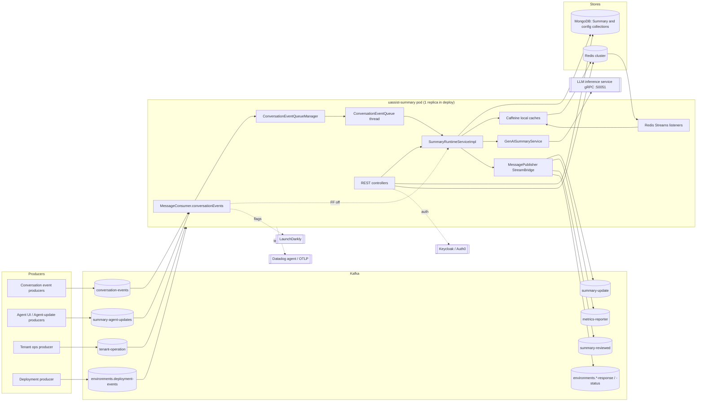
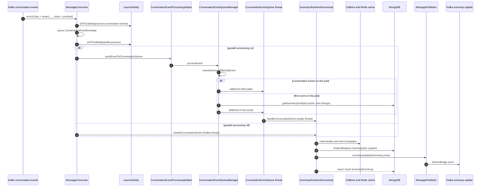
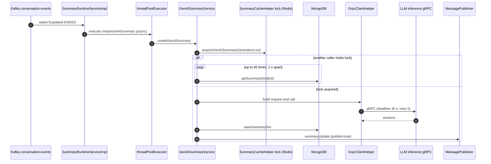
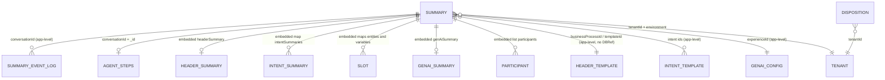
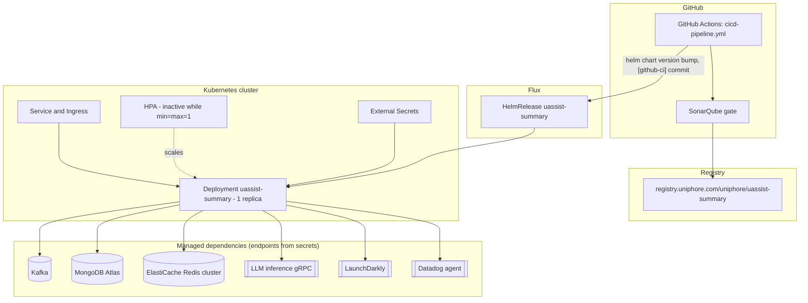

# uassist-summary — Architecture Reference

> Scope: this repository only (`com.uniphore.uassist:uassist-summary`, Spring Boot 3.5.14 / Java 17).
> Labels used throughout:
> - **[Implemented]** — seen in source code that was read.
> - **[Configured]** — set in `application*.yml`, `pom.xml`, Helm values, Garden or Flux files.
> - **[Inferred]** — a conclusion drawn from code plus framework defaults; not run or confirmed.
> - **[Unknown]** — cannot be determined from this repository.
>
> Secret values present in the repo are deliberately not reproduced here.

---

## 1. Executive Summary

`uassist-summary` is a Spring Boot backend service in Uniphore's **U-Assist** contact-centre platform. It builds and maintains a **live, per-conversation summary** of a customer call, which agents see in the U-Assist UI.

The service:

1. Consumes **conversation events** (call started, entity/variable/intent changes, transcript chunks, flow ended, state changes, policy blocks) from Kafka.
2. Folds those events into one **`SummaryDoc`** aggregate per conversation in **MongoDB**, using **header** and **intent** templates and configuration that are cached in **Redis** and in-process **Caffeine** caches.
3. Calls an external **LLM inference service over gRPC** to produce a **GenAI summary** when a call ends (or on demand, or from the review/submit flow).
4. Publishes the resulting **summary snapshots** back to Kafka (`summary-update`) and emits metrics events (`metrics-reporter`).
5. Exposes a **REST config and runtime plane** (templates, dispositions, GenAI config, agent notes/edits/intents, summary review, reports).
6. Handles **environment promotion** (export / import / rollback / deployment tasks) and **tenant data deletion** through Kafka-driven workflows.

Architecturally it is a **single-deployable, modular monolith** packaged as one JAR. It is **stateful**: each pod keeps an in-memory event queue and per-conversation bookkeeping. In the deployed configuration it runs as **one replica** [Configured].

---

## 2. Business Functionality

| Capability | What it does | Where (main classes) |
|---|---|---|
| Live call summary | Builds a header summary and per-intent summaries from entity/variable events | `SummaryRuntimeServiceImpl.handleConversationEvent`, `util/SummaryHelper` |
| Template-driven summaries | Maps entities/variables to header and intent templates | `cache/HeaderTemplateCacheHelper`, `cache/IntentTemplateCacheHelper`, `service/*TemplateServiceImpl` |
| GenAI summary | Sends call context to an LLM and stores sectioned output | `service/GenAISummaryService`, `util/GenAiSummaryHelper` (1,462 lines), `util/GrpcClientHelper` |
| GenAI configuration | Per-experience / per-call-type GenAI settings | `controller/GenAISummaryConfigController`, `service/GenAISummaryConfigServiceImpl` |
| Agent interaction | Agent notes, summary edits, intent add/delete, agent steps, submit/review | `controller/SummaryRuntimeController`, `util/SummaryHelper.handleAgentNotesUpdate`, `handleIntentAddByAgent` |
| Dispositions | Call disposition taxonomy (levels) | `controller/DispositionController`, `service/DispositionServiceImpl` |
| Reporting | Per-conversation report and event metrics | `SummaryRuntimeServiceImpl.getSummaryReportByConversationId`, `controller/MetricController` (`/v2/report-by-convid`) |
| Environment promotion | Export/import/rollback summaries and config between environments | `controller/ExportImportController`, `service/ExportImportServiceImpl`, `deployment/*` |
| Tenant deletion | Sweeps all collections for a tenant | `kafka/TenantOperationEventConsumer.createDeleteTenantDataTask` |
| Feature gating | LaunchDarkly flags gate most new behaviour | `LaunchDarklyHelper`, `controller/FeatureFlagController` |

**Users** [Inferred]: contact-centre **agents** (their UI reads summaries), **supervisors/admins** (configure templates, GenAI settings, dispositions), and **platform/ops** (environment promotion). The chart sets `usedBy: "uassist,xconsole"` (`charts/uassist-summary/values.yaml`) — the consuming UIs are not in this repository.

**Core features** (implemented): event-driven summary building; template mapping; GenAI generation (template/NG mode and section mode); short-call canned responses; agent edit/notes/intent flows; multi-language targets (`GENAI_SUMMARY_TARGET_LANGUAGES` default `en-us,fr-fr,es-us,it-it`); metrics to Looker-oriented topic; config export/import.

---

## 3. Technology Stack

| Area | Technology | Version (evidence) | Where used | Why / responsibility |
|---|---|---|---|---|
| Language | Java | 17 (`pom.xml` `java.version`) | everything | LTS, Spring Boot 3 requirement |
| Backend framework | Spring Boot | 3.5.14 (parent POM) | all | DI, web, config, actuator |
| Cloud messaging | Spring Cloud Stream + Kafka binder | BOM `spring-cloud.version` 2025.0.0 | `application-kafka-binder.yml`, `kafka/*` | Functional `Consumer`/`StreamBridge` bindings |
| Kafka | Apache Kafka (SASL/PLAIN capable) | client via Spring Cloud | topics listed in §4 | Event backbone |
| Database | MongoDB | driver managed by Boot (version unpinned here) | `dao/*`, `dao/documents/*` | Document store for `SummaryDoc` aggregate |
| Mongo access | Spring Data MongoDB + `MongoTemplate` | Boot-managed | `dao/SummaryRuntimeDao` | Upsert/replace and queries |
| Cache (shared) | Redis (cluster mode, Lettuce) | Boot-managed; `spring-data-redis` | `application-redis.yml`, `CacheOperations` from `platform-cache` | Cross-pod cache, Redis Streams |
| Cache (local) | Caffeine | Boot-managed | `cache/HashLocalCache.java` (imports `com.github.benmanes.caffeine`) | Tier-1 in-process cache |
| Streams | Redis Streams | via Spring Data Redis | `redisstream/*` | Cross-pod invalidation and agent-update fan-out |
| RPC | gRPC (`grpc-netty` 1.77.0, `grpc-spring-boot-starter` 4.9.1, `netty` 4.1.132.Final) | `pom.xml` | `util/GrpcClientHelper` | Calls the LLM inference service `LLMInferenceServiceGrpc` |
| Protobuf | protobuf-java 3.21.12; `uniphore-protos-java` pinned to git sha `7be0778` | `pom.xml` | `model/ProtoConverter`, all Kafka payloads | Typed event/summary schemas |
| Web | Spring MVC (embedded Tomcat, `tomcat.embed` 10.1.54) | Boot-managed | `controller/*` | REST API on port 3380 |
| JSON | Jackson 2.18.4 (msgpack dataformat present) | `pom.xml` | DTOs | |
| Feature flags | LaunchDarkly via internal `feature-flag` 2.4.0.0 | jar in `internal-lib/` | `LaunchDarklyHelper`, `MessageConsumer` | Runtime gating |
| Auth | Keycloak (token URL / introspection config), Auth0 IdP setting, `common-authorization` 2.4.0.0 jar | `application.yml`, `internal-lib/common-authorization-2.4.0.0.jar` | `X-Username` request attribute | See §9 for depth and unknowns |
| Security framework | `spring-boot-starter-security`; property `spring.security.version` 6.5.10 | `pom.xml` | jar-driven | Dependency present; no app-level `SecurityFilterChain` in `src/main` |
| Metrics | Micrometer (Prometheus registry, StatsD registry), `java-dogstatsd-client` 4.2.0 | `pom.xml`, `application.yml` | `common/CustomMetricsPublisher`, `helper/MetricHelper` | Operational metrics |
| Tracing | Datadog `dd-java-agent` (pom dep 1.26.0; Docker `-javaagent` 1.10.0), OpenTelemetry API/SDK/OTLP exporter, OpenTracing shims, `platform-telemetry` | `pom.xml`, `Dockerfile` | `conf/OpenTelemetryConfig`, `ContextSetter` | Distributed tracing with tenant tags |
| Resilience | Spring Retry (`@Retryable`, `RetryTemplate`), gRPC retry policy, `threadPoolExecutor` queues | `conf/MongoConfig`, `SummaryApplication` | Mongo client creation, RestTemplate, gRPC | Transient failure handling |
| Mapping | Lombok | `lombok.config` | DTOs | Boilerplate reduction |
| HTTP client | Apache HttpClient 4.5.14 (for RestTemplate), httpclient5 | `pom.xml`, `SummaryApplication` | outbound REST (`ocms`, `cms`, user-mgmt) | |
| HTML parsing | jsoup 1.10.2 | `pom.xml` | `common/HtmlParser` | Parsing HTML in summary content (not reviewed in depth) |
| Validation | Jakarta Validation 3.0.2; `spring-boot-starter-validation`; `common/BeanValidation` | `pom.xml` | request validation | |
| Testing | JUnit 5 (Boot), Mockito (`mockito-inline` 4.0.0), Spring Boot test, Testcontainers 1.20.6 (Mongo, Kafka, Redis), Cucumber 7.21.1 (`cucumber-spring`, `cucumber-junit`), JaCoCo 0.8.8, Surefire 2.19.1 | `pom.xml`, `src/test` | 78 `*Test.java` files; 1 Cucumber runner `CucumberIT` | |
| Build | Maven wrapper (`mvnw`), Spring Boot plugin with `includeSystemScope=true` | `pom.xml` | `target/uassist-summary.jar` | Fat JAR including `system`-scope jars |
| Container base | Chainguard JRE `openjdk-17` | `Dockerfile` | runtime image | Minimal, hardened base |
| Container build | Docker (`docker-build.sh`), Garden `jib-container` module | `docker-build.sh`, `uassist-summary.garden.yml` | local/dev image | |
| Packaging/deploy | Helm chart `uassist-summary` (version `0.2.35-v44644f09`) | `charts/uassist-summary/` | Kubernetes | |
| GitOps | Flux `HelmRelease` + Kustomize overlays (`base`, `staging`, `canary`, `prod-v2`) | `deploy/*/release.yaml` | cluster | Declarative deployment |
| Dev environment | Garden (`project.garden.yml`) incl. Kafka, Mongo, Redis, Postgres modules | `project.garden.yml` | dev | Local/dev orchestration |
| Autoscaling | HPA with Datadog external metric (Kafka lag) | `charts/uassist-summary/templates/hpa.yaml`, `dd_metric.yaml` | k8s | Designed to scale on consumer lag |
| Secrets | Kubernetes secrets via External Secrets (`uniphore/<region>/...` paths) | `charts/.../values.yaml`, `deploy/base/release.yaml` | k8s | Injected as env |
| CI/CD | GitHub Actions calling shared `uniphore/platform-github-actions` (`ci.yml`, `cd.yml`), SonarQube quality gate | `.github/workflows/cicd-pipeline.yml` | build/test/publish | CD only on default branch |
| Feature-flag/OCMS/CMS/Caesium | Internal HTTP services | `application.yml` (`ocms`, `caesium`, `platform.cms.endpoint`) | config lookups | [Inferred usage] |
| Logging | Logback (`logback.xml`) with level variables | `src/main/resources/logback.xml` | all | |

**Frontend:** none in this repository [Implemented: no UI code]. The UI is consumed externally.

**Not found in this repository:** a relational database (no JPA/SQL drivers), an API gateway config, an ingress definition beyond `domainName` in the Helm release, a WAF, a rate limiter, and a service mesh config.

---

## 4. Architecture Overview

### 4.1 Style

**Modular monolith, single deployable, stateful pods.** Packages are separated by responsibility (`kafka`, `event`, `service`, `dao`, `cache`, `controller`, `deployment`, `redisstream`, `util`, `conf`). There is no service split and no separate worker tier. Concurrency lives in-process (one queue thread, Kafka consumer threads, `threadPoolExecutor`, `threadPoolMongoExecutor`, a scheduler).

### 4.2 Main modules / packages

| Package (under `com.uniphore.uassist.summary`) | Responsibility | Key classes |
|---|---|---|
| root | Bootstrap | `SummaryApplication` (component-scans `com.uniphore.ri.auth`, `platform.cache`, `featureflag`, `platform.telemetry`, `ri.common.usermgmt`, `encryption`) |
| `kafka` | Kafka function beans and publisher | `MessageConsumer` (`conversationEvents`, `agentUpdate`), `TenantOperationEventConsumer`, `MessagePublisher` |
| `deployment` | Environment promotion | `stream/DeploymentTaskListener`, `service/DeploymentService`, `service/DeploymentCommonService` |
| `event` | Event fan-out and per-pod queue | `service/ConversationEventQueueManager`, `processing/ConversationEventQueue`, `scheduler/ConversationProcessorMapCleaner`, `helper/ConversationEventProcessingHelper` |
| `service` | Business logic | `SummaryRuntimeServiceImpl` (2,368 lines), `GenAISummaryService`, `GenAISummaryConfigServiceImpl`, `HeaderTemplateServiceImpl`, `IntentTemplateServiceImpl`, `DispositionServiceImpl`, `ExportImportServiceImpl`, `MetricService`, `PlatformServiceImpl`, `CSVService` |
| `util` | Domain helpers | `SummaryHelper` (669 lines), `GenAiSummaryHelper` (1,462 lines), `GrpcClientHelper`, `PolicyHelper`, `ProtoConverter`-adjacent helpers, `DateUtil`, `KafkaUtil` |
| `dao` | Persistence | `SummaryRuntimeDao`, `*Dao` wrappers, `*Repo`/`*Repository` Spring Data interfaces (`SummaryRepository` uses `@Query` with positional params) |
| `dao/documents` | Mongo `@Document` classes | `SummaryDoc`, `HeaderSummaryDoc`, `IntentSummaryDoc`, `GenAiSummaryDoc`, `AgentNotesDoc`, `AgentStepsDoc`, `SummaryUpdateEventLog`, `*TemplateDoc`, `DispositionDoc`, … |
| `cache` | Caching | `CommonCacheHelper` (key builder), `LocalCacheBeans`, `HashLocalCache`, `ListLocalCache`, `SummaryCacheHelper` (lock), `*CacheHelper` per config type |
| `redisstream` | Redis Stream listeners/publishers | `RedisStreamConfig`, `ConfigChangeEventPublisher`, `ConfigChangeEventListener`, `AgentUpdateEventPublisher`, `AgentUpdateEventListener` |
| `controller` | REST | `SummaryRuntimeController`, `GenAISummaryConfigController`, `HeaderTemplateController`, `IntentTemplateController`, `DispositionController`, `ExportImportController`, `DeploymentController`, `MetricController`, `HealthController`, `FeatureFlagController` |
| `conf` | Spring config | `MongoConfig`, `ThreadPoolConfig`, `DataStreamConfig`, `OpenTelemetryConfig`, `ApplicationShutdownListener`, `MongoMapKeyDotReplacementConfiguration` |
| `helper` | Metrics | `LookerGenAISummaryMetricHelper`, `MetricHelper` |
| `common` | Shared | `Constants`, `Commons`, `CustomMetricsPublisher`, `HtmlParser`, `TemplateConfigurer`, `BeanValidation` |
| `execption` (sic) | Errors | `CustomException`, `GenAiException`, `ErrorCodes`, `ExceptionAdviceHandler`, `ErrorResponse` |
| `model` | DTOs and converters | `ProtoConverter` (372 lines), `DocConverter` (516 lines), request/response POJOs |
| `mock` | `MockService` (`@Service`, 587 lines) | Purpose not determined in depth — [Unknown] |

### 4.3 Architecture diagram

### 4.4 Internal communication

- **Async, inbound:** Kafka → Spring Cloud Stream function beans (`conversationEvents`, `agentUpdate`, `tenantOperation`, `deploymentRequest`).
- **Async, outbound:** `MessagePublisher` → `StreamBridge.send(...)` to bindings named `*-out-0` (see §4.6). All publishing goes through this class per CLAUDE.md, and the code matches that.
- **In-process async:** `ConversationEventQueue` (`Thread` + `LinkedBlockingQueue`), `threadPoolExecutor` (`conf/ThreadPoolConfig`), `threadPoolMongoExecutor` (`@Async` on Mongo writes such as `SummaryRuntimeDao.saveSummaryEventDoc`).
- **Cross-pod:** Redis Streams for config-change and agent-update events (`redisstream/*`).
- **Sync outbound:** gRPC blocking stub to the LLM service (`GrpcClientHelper`); `RestTemplate` for `ocms`, `cms`, user-management.
- **Sync inbound:** REST on port 3380.

### 4.5 Background jobs and workers

| Worker | Mechanism | Where | Notes |
|---|---|---|---|
| Conversation event processor | Single `Thread` with `LinkedBlockingQueue`, `poll(30s)` when running | `event/processing/ConversationEventQueue.run` | One per pod; FIFO across all conversations |
| Idle conversation evictor | `@Scheduled(fixedDelayString=...frequency)` | `event/scheduler/ConversationProcessorMapCleaner` | Removes timestamps for idle conversations from the in-memory map |
| Config/agent stream listeners | `StreamMessageListenerContainer` | `redisstream/RedisStreamConfig` | Started as `@Bean`s |
| Mongo async writes | `@Async("threadPoolMongoExecutor")` | `SummaryRuntimeDao` | Event log writes |
| GenAI generation | `threadPoolExecutor.execute(...)` | `SummaryRuntimeServiceImpl.handleConversationStateUpdated`, `summaryReviewed` | Off the queue thread |
| Export/import/rollback | Dedicated executors | `ExportImportServiceImpl`, `tenantOperationExecutorService` | Replies on `environments.*-response` |
| Deployment tasks | Kafka consumer | `DeploymentTaskListener` → `DeploymentService.deploySummaries` | |

### 4.6 Kafka bindings (verified in `application-kafka-binder.yml`)

| Binding | Direction | Destination (default) | Group (default) |
|---|---|---|---|
| `conversationEvents-in-0` | in | `conversation-events` | `summary-group` (deployed: `summary`) |
| `conversationEvents-out-0` | out | `conversation-events` | — |
| `agentUpdate-in-0` | in | `summary-agent-updates` | `uassist-summary` |
| `agentUpdate-out-0` | out | `summary-agent-updates` | — |
| `tenantOperation-in-0` | in | `tenant-operation` | `uassist-summary` |
| `deploymentRequest-in-0` | in | `environments.deployment-events` | `summary-deployment` |
| `deploymentResponse-out-0` | out | `environments.deployment-status` | — |
| `summaryUpdate-out-0` | out | `summary-update` | — |
| `summaryReviewed-out-0` | out | `summary-reviewed` | — |
| `conversationReviewed-out-0` | out | `conversation-reviewed` | — |
| `metricReportEvents-out-0` | out | `metrics-reporter` | — |
| `exportResponse-out-0` / `importResponse-out-0` / `rollbackResponse-out-0` | out | `environments.{export,import,rollback}-response` | — |

`spring.cloud.function.definition: conversationEvents;deploymentRequest;agentUpdate;tenantOperation` [Configured]. Consumer `partition.assignment.strategy` is `CooperativeStickyAssignor` [Configured].

### 4.7 Configuration management

- **Layering:** `application.yml` (base) → `spring.config.import` of `application-kafka.yml` and `application-kafka-binder.yml` → profiles `redis,mongo,kafka` always active (`spring.profiles.active`) [Configured].
- **Env-var overrides:** every setting uses `${ENV:default}` [Configured]. Helm `values` and the Flux `release.yaml` set the real environment values, sourced from External Secrets (`elastic-credentials-summary`, `kafka-auth-config`, `launchdarkly-uniphore`, `mongo-atlas-credentials-summary`) [Configured].
- **Runtime config:** tenant-scoped configuration (templates, dispositions, GenAI config) lives in MongoDB and is cached (§6.4). Feature flags come from LaunchDarkly [Implemented].
- **Known inconsistency:** `ThreadPoolConfig` reads `thread.core-pool-size`, `thread.max-pool-size`, `thread.queue-capacity`, `thread.keep-alive-time`, but `application.yml` defines `thread.corePoolSize`, `maxPoolSize`, `queueCapacity`, `keepAliveTime`. Spring Boot relaxed binding may or may not make these match for `@Value`. [Unknown — verify at runtime, e.g. with the actuator `env` endpoint.]

---

## 5. Architecture Deep Dive

### 5.1 Frontend architecture
None in this repository [Implemented]. The API is consumed by the U-Assist UI and an `xconsole` client [Inferred from `usedBy`].

### 5.2 Backend architecture
Layers: **Kafka / REST adapters → Services (`SummaryRuntimeServiceImpl`, `GenAISummaryService`, config services) → Helpers (`SummaryHelper`, `GenAiSummaryHelper`) → DAOs (`SummaryRuntimeDao`, `*Dao`) → Mongo; caches via `*CacheHelper`; outbound via `MessagePublisher` and `GrpcClientHelper`.**

Note that `SummaryRuntimeServiceImpl` and `SummaryHelper` both mutate the same `SummaryDoc` and both call `saveSummaryDoc`/`saveAndPublish`. Ownership is not cleanly separated (see §12).

### 5.3 Database architecture
See §8. One MongoDB database (`MONGO_DB`, default `summary`); tenant and environment are fields on documents, not separate databases [Implemented].

### 5.4 External services
| Service | Protocol | Config keys | Used for |
|---|---|---|---|
| LLM inference | gRPC (blocking stub, deadline, retry) | `gen-ai.interface.*` (default `llm-inference.ai:50051`) | GenAI summary text |
| LaunchDarkly | SDK | `launchdarkly.*`, `LD_SDK_KEY` | Feature flags |
| Keycloak | OIDC token + introspection URLs | `app.keycloak.*` | Token validation (via jar) |
| Auth0 | IdP name | `IDP=auth0` | Config value only |
| OCMS | HTTP | `ocms.endpoint` | Lookups [Inferred use] |
| CMS | HTTP | `platform.cms.endpoint` | Lookups [Inferred use] |
| Caesium | HTTP | `caesium.endpoint` | [Unknown use] |
| User management | HTTP | `usermanagement.endpoint` | User lookups [Inferred] |
| Datadog / OTLP | StatsD, OTLP HTTP | `DD_AGENT_HOST`, `OTEL_EXPORTER_OTLP_ENDPOINT` | Metrics and traces |
| Redis | RESP (Lettuce, cluster) | `spring.data.redis.*` | Cache + streams |
| MongoDB | Mongo wire | `spring.data.mongodb.*` | System of record |
| Kafka | Kafka protocol (PLAIN SASL configurable) | `spring.kafka.*`, binder props | Events |

### 5.5 Internal service communication
Only Kafka, Redis, Mongo and gRPC/HTTP as above. No service-to-service REST between components of this repo [Implemented].

### 5.6 Authentication flow
- The **`X-Username` request attribute** is what controllers depend on: `@RequestAttribute(Constants.X_USERNAME)` (`common/Constants.java:47`) is used in `SummaryRuntimeController`, `GenAISummaryConfigController`, `DispositionController`, `HeaderTemplateController`, `IntentTemplateController`.
- The code that sets it is **not in this repo**. `internal-lib/common-authorization-2.4.0.0.jar` contains `com/uniphore/ri/auth/httpserver/TokenAuthorizationFilter`, `TenantCommonFilter`, and `com/uniphore/ri/auth/security/SecurityConfig` [Implemented in the jar listing]. The jar is picked up by `@ComponentScan("com.uniphore.ri.auth")` in `SummaryApplication`.
- [Inferred] `TokenAuthorizationFilter` introspects a bearer token against Keycloak (`app.keycloak.introspection.url`) and `TenantCommonFilter` sets tenant context. [Unknown] whether the filter is active in each environment.
- `ExportImportController` reads `Constant.AUTHORIZATION` from the request header and forwards it [Implemented].

### 5.7 Authorization flow
- Coarse: the jar-provided filter authenticates the caller. The app itself performs **no role checks** — no `@PreAuthorize`, no role annotations in `src/main` [Implemented].
- Fine-grained: ownership is via `tenantId` and `environment` from `TenantContext`/`TenantUtils`, applied to every Mongo query and cache key [Implemented].
- Caller identity is recorded from `X-Username` (for audit) and overwrites any caller-supplied agent identity per CLAUDE.md [Configured/Documented]; the actual overwrite was not located line-by-line.

### 5.8 Error handling
- Central: `execption/ExceptionAdviceHandler` maps `CustomException` / `ErrorCodes` to `ErrorResponse` [Implemented].
- Kafka consumers catch and log everything so offsets keep advancing (`MessageConsumer.conversationEvents`). This means **failed events are dropped, not retried** [Implemented].
- `SummaryHelper.saveAndPublish` catches all exceptions and logs (`util/SummaryHelper.java` ~L162–185). A failed publish is **silently lost** after the Mongo save succeeded [Implemented].
- `SummaryRuntimeController.GenerateSummary` (`/v1/generate-summary`) catches all exceptions and returns `200` with empty sections [Implemented]. Callers cannot distinguish "no summary" from "error".
- GenAI retries: `GenAISummaryService.executeWithGrpcUnavailableRetry` retries on gRPC `UNAVAILABLE`; the channel also has `enableRetry().maxRetryAttempts(5)` [Implemented].

### 5.9 Configuration management — see §4.7.

---

## 6. End-to-End Data Flows

### 6.1 Operation 1 — Conversation event ingestion (hot path)

**Trigger:** a record on `conversation-events`.

1. `kafka/MessageConsumer.conversationEvents()` (`Consumer<Message<byte[]>>`):
   - Reads the Kafka key; the first `_`-segment is used as tenant id (`ContextSetter.setContext(split[0], "dev")`). The environment is **hard-coded to `"dev"`** at this point [Implemented — see §12].
   - Calls `ldHelper.isFFEnabled("uassist-process-conversation-events")`; returns if off.
   - Parses the bytes with `ConversationEventEnvelope.parseFrom`.
   - Re-sets context with tenant/environment from the envelope.
   - If `TARGET_PRODUCTS_ENABLE_FF` is on, drops messages whose `targetProductsList` lacks `PRODUCT_TYPE_U_ASSIST`.
2. **Branch on `SUMMARY_PARALLEL_PROCESS_ENABLED`:**
   - **On:** `ConversationEventProcessingHelper.pushEventToConversationQueue(envelope)` → `ConversationEventQueueManager.processEvent(...)`.
   - **Off:** `PolicyHelper.isConversationBlocked(...)`; if not blocked, `SummaryRuntimeServiceImpl.handleConversationEvent(envelope, now)` runs **on the Kafka consumer thread**.
3. `ConversationEventQueueManager.processEvent`:
   - `checkSummaryEffectedEvent` returns true only if one of 13 event fields is non-empty (presence test via `toString()`).
   - `ConversationStarted` → record the conversation in `conversationIdLastUpdatedTimeStamp` and enqueue.
   - Otherwise `checkSummaryDocAndProcessEvent`:
     - **Fast path:** conversation already in the in-memory map → refresh timestamp, enqueue.
     - **Slow path:** `SummaryHelper.getSummaryDocById` (cache → Mongo) → enqueue only if the doc exists; otherwise drop with a warning.
4. `ConversationEventQueue.run()` (single thread) polls, sets `ContextSetter` span, and calls `SummaryRuntimeServiceImpl.handleConversationEvent`.
5. `handleConversationEvent` is an **`if / else if` chain**: only the **first** matching event type in the envelope is handled. Order: `entityAdded`, `entityUpdated`, `variablesAdded`, `intentsAdded`, `intentDeleted`, `variablesUpdated`, `conversationStarted`, `flowEnded`, `stateV2Updated`, `stateUpdated`, `policiesAdded`, `transcriptChunkAdded`.
6. The handler loads the `SummaryDoc` (`summaryHelper.getSummaryDoc`), updates header/intent summaries using cached templates (`HeaderTemplateCacheHelper`, `IntentTemplateCacheHelper`), then:
   - If anything changed: `summaryHelper.saveAndPublish(doc, proto, eventLog)`:
     1. `saveSummaryDoc` — `MongoTemplate.findAndReplace(..., upsert)` on the whole document.
     2. `messagePublisher.summaryUpdate(proto)` → `summary-update` topic.
     3. `saveSummaryEventDoc` — **async** insert into `SummaryEventLog` (`threadPoolMongoExecutor`).
   - Otherwise: save only.

**Caching:** Caffeine (`HashLocalCache`, TTL `local.cache.ttl.config` 1800s) → Redis (`CacheOperations`, key `uniphore.summary.<tenant>.<env>...`) → Mongo.
**Async:** the queue thread is async with respect to Kafka; the event log write is `@Async`; publishing is synchronous.
**Response:** none (Kafka consumer).

### 6.2 Operation 2 — Conversation ends → GenAI summary

**Trigger:** a `stateV2Updated` (ENDED) or `stateUpdated` (FINISHED) event.

1. `handleConversationStateUpdated` (`SummaryRuntimeServiceImpl` ~L518) checks `UASSIST_STATE_V2_UPDATE_FF` to choose which state field to read.
2. If `GENAI_SUMMARY_FF` is on: `threadPoolExecutor.execute(...)` → `GenAISummaryService.createGenAiSummary(convId, tenantId, experienceId, publish=true, ...)`.
3. `createGenAiSummary`:
   - Reads flags (NG template, entity enhancement, stream summary).
   - `SummaryCacheHelper.acquireGenAiSummaryGenerationLock(convId)` — returns **`true` if someone else already holds the lock**.
   - If the lock is held by another caller: `checkSummaryInDbWithRetries` polls Mongo up to **45 × 1 s** (code) for a populated `genAiSummary.sections`. (CLAUDE.md says 20; the code says 45.)
   - Otherwise: `GenAiSummaryHelper` builds the request. Modes: **NG template** (`templateId` + `version`) when `ENABLE_NG_TEMPLATE_BASED_GENAI_SUMMARY`; otherwise a **section-based** request (call reason, agent actions, outcome, sentiment). **Short-call** config can skip the LLM and store a canned message (`isShortCall`).
   - `GrpcClientHelper` calls `LLMInferenceServiceGrpc` (unary or streaming) with a deadline of `GRPC_CALL_DEADLINE_SECONDS` (30 s).
   - `publishGenAiSummary` → `saveAndPublish` (publish=true) or `saveSummaryDoc` only.
4. `resetGenAIRequested` / `removeGenAIRequested` clear the lock on completion paths [Implemented in `SummaryCacheHelper`].

**Trade-off:** the lock is non-atomic (see §12). Multiple pods can end up calling the LLM for the same conversation.

### 6.3 Operation 3 — Agent summary edit (REST)

**Trigger:** `PUT /v1/agent-edits` (and the agent-steps / intent endpoints).

1. `SummaryRuntimeController` (`controller/SummaryRuntimeController.java:63`) receives `AgentRequestPayload`, reads `X-Username`.
2. `SummaryRuntimeServiceImpl.saveAgentEdits` (L146): loads the summary by conversation or by external id (`summaryRuntimeDao.getSummaryByExtId`, L218).
3. `summaryHelper.handleSummaryTemplateEdits` (`util/SummaryHelper` L351) applies the edit and calls `saveAndPublishAgentEdits` → `saveAndPublish`.
4. In parallel, `processAgentUpdates` (L227) handles `AgentUpdateRequest` objects that arrive from `summary-agent-updates` (`MessageConsumer.agentUpdate`) or from the queue when `UASSIST_AGENT_EDITS_QUEUE_PROCESSING` is on. [Partially traced: whether the REST path is also routed through the queue depends on that flag and was not fully traced.]

**Important:** this REST write runs on a Tomcat thread and **does not go through the single queue thread**, so it can race with queued Kafka events for the same conversation (§12).

### 6.4 Operation 4 — Read summary (REST)

**Trigger:** `GET /v1/summary` (`SummaryRuntimeController` L295) → `SummaryRuntimeServiceImpl.fetchSummary` (L1577) → `summaryHelper.getSummaryDoc`.

- Read path: `SummaryCacheHelper.find` → `CacheOperations<SummaryDoc>` (Redis, key `uniphore.summary.<tenant>.<env>` + conversation id) → Mongo `SummaryRuntimeDao.getSummaryDoc`.
- Bulk: `GET /v1/summaries`, `POST /v1/summaries-list` → `fetchSummaries` / `SummaryRuntimeDao.getSummaryDocs(List)` (query shape not inspected).
- Event history: `GET /v1/event-logs` → `SummaryRuntimeDao.getSummaryEventLog`.
- Report: `GET /v1/summary-report` → `getSummaryReportByConversationId` (L1666) → aggregation `getSummaryAggrByEventForConvId`.

**Caching:** Redis for summary reads [Implemented]; the CLAUDE.md "Caffeine → Redis → Mongo" tiering applies to config caches, and [Inferred] to the summary as well.

### 6.5 Operation 5 — Agent submits / reviews summary (REST)

**Trigger:** `POST /v1/agent/summary-reviewed` (`SummaryRuntimeController` L110) → `SummaryRuntimeServiceImpl.summaryReviewed` (L660).

1. If the summary exists: `saveSummaryDoc` → `submitSummary` (the submit path publishes downstream; the exact topic was not traced — `summary-reviewed` is the configured binding), metrics via `LookerGenAISummaryMetricHelper`.
2. If it does not: `threadPoolExecutor.execute(...)` → `createGenAiSummary(..., publish=false)` → then submit when the result arrives.
3. `agentStepsCacheHelper` and `intentTemplateCacheHelper` are cleared on submit, and `genAISummaryService.resetGenAIRequested` resets the lock.

### 6.6 Operation 6 — Config write (e.g. header template) with cross-pod invalidation

**Trigger:** `PUT /v1/header-template` (`HeaderTemplateController` L28).

1. `HeaderTemplateServiceImpl` → `HeaderTemplateDao` → Mongo upsert.
2. `HeaderTemplateCacheHelper` evicts its local/Redis entries and calls `ConfigChangeEventPublisher` (also called from Disposition, GenAI config and intent cache helpers).
3. The Redis stream `uassist-summary-config-changes` fans out. **Every pod** reads it through `ConfigChangeEventListener`, which deletes the matching Caffeine entries.
4. Other pods serve stale config until their local TTL expires, or until they receive the event.

**Failure mode:** a pod that is down or restarting misses the event. The stream read uses `ReadOffset.lastConsumed()` with **no consumer group** (`redisstream/RedisStreamConfig.java` ~L55, L76), so there is no replay. Stale data lasts up to `local.cache.ttl.config` (1800 s) [Inferred from code].

### 6.7 Operation 7 — Environment promotion (export → import)

- **Export:** `GET /export/{expId}/summary` → `ExportImportServiceImpl` → response on `environments.export-response`.
- **Import:** `POST /import/summary` (reads the body as `ExportImportSummary`, forwards the `Authorization` header) → `environments.import-response`.
- **Rollback:** `POST /rollback/{expId}/summary` → `environments.rollback-response`.
- **Deployment task:** `environments.deployment-events` → `DeploymentTaskListener` → `DeploymentService.deploySummaries` → status on `environments.deployment-status`.

Each step runs on its own executor. Status is reported through Kafka; there is no polling API for status in this repo.

### 6.8 Operation 8 — Tenant deletion

`tenant-operation` → `TenantOperationEventConsumer` → `createDeleteTenantDataTask(tenantId)` runs on `tenantOperationExecutorService` (5–10 threads, queue 100). It issues `deleteBy...TenantId` on 8 repositories: agent edits, dispositions, GenAI config, header templates, intent templates, summaries, summary event logs, agent steps [Implemented]. **Not atomic**; a partial failure leaves a partly deleted tenant. Caches are not explicitly cleared in that path [Implemented — not seen].

### 6.9 Operation 9 — Policy block

`PoliciesAdded` with `POLICY_ACTION_TYPE_BLOCKLIST` → `handlePolicyAddedEvent` → `summaryHelper.deleteSummaryDoc(convId)`. Also `PolicyHelper.isConversationBlocked` is checked on the non-queue path. [Implemented]

### 6.10 Operation 10 — Health and metrics

- `GET /health/startup|liveness|readiness` → `HealthController`.
- `GET /actuator/prometheus`, `/actuator/health`, `/actuator/info`, `/actuator/metrics` (exposure set in `application.yml`) [Configured].
- Product metrics: `LookerGenAISummaryMetricHelper` → `MessagePublisher.metricReport` → `metrics-reporter` topic.
- `GET /v1/event-metrics` → `ConversationEventQueueManager.getMetrics()` (queue size and last-event time).

---

## 7. Module Breakdown (the important classes, with size)

| Class | Lines | Role |
|---|---|---|
| `service/SummaryRuntimeServiceImpl` | 2,368 | Event handler chain, agent operations, submit/review, reports |
| `util/GenAiSummaryHelper` | 1,462 | Builds GenAI requests, short-call logic, section assembly |
| `util/SummaryHelper` | 669 | Save/publish, summary template edits, agent event logs |
| `model/DocConverter` | 516 | Doc ↔ DTO conversion |
| `service/GenAISummaryService` | 510 | GenAI orchestration, lock, retry, publish decision |
| `model/ProtoConverter` | 372 | Doc → protobuf `Summary` |
| `controller/SummaryRuntimeController` | 367 | Runtime REST |
| `service/ExportImportServiceImpl` | 349 | Export/import/rollback |
| `util/GrpcClientHelper` | 284 | LLM gRPC client |
| `kafka/MessageConsumer` | 134 | Kafka entry points |
| `event/service/ConversationEventQueueManager` | ~130 | Fan-out, fast/slow path |
| `event/processing/ConversationEventQueue` | ~110 | Per-pod single thread |
| `redisstream/*` | small | Cross-pod invalidation |

Total: 15,701 lines of Java under `src/main/java` (per `wc -l`).

---

## 8. Database Design (MongoDB)

**Database:** one database (`spring.data.mongodb.database`, default `summary`). Multi-tenancy is a **shared-database, shared-collection** model with `tenantId` + `environment` fields.

### 8.1 Collections (from `@Document`)

| Collection | Class | Key | Indexes (from annotations) | Role |
|---|---|---|---|---|
| `Summary` | `SummaryDoc` | `_id` = `conversationId` | compound `{tenantId,environment,conversationId}`; compound `{tenantId,environment,extConversationId}`; `@Indexed` on `timestamp` (embedded `TimeStampDoc`) and `extConversationId` | **The aggregate.** One per conversation |
| `SummaryEventLog` | `SummaryUpdateEventLog` | [Unknown key] | `@Indexed` on two fields (L28, L30) | Append-only history of summary updates |
| `AgentSteps` | `AgentStepsDoc` | `_id` = `conversationId` (from `findById(convId)` usage) | compound `summary_compound_index` | Agent step list (1:1 with conversation) |
| `HeaderTemplate` | `HeaderTemplateDoc` | [Unknown] | `@Indexed` (L18) | Header template config |
| `IntentTemplate` | `IntentTemplateDoc` | [Unknown] | `@Indexed` (L16) | Intent template config |
| `GenAISummaryConfig` | `GenAISummaryConfigDoc` | [Unknown] | none seen | GenAI settings per experience |
| `Disposition` | `DispositionDoc` | [Unknown] | none seen | Disposition taxonomy |
| `AgentEdits` | `AgentEditsDoc` | [Unknown] | none seen | Agent edit records |
| `AgentNotes` | `AgentNotesDoc` | embedded in `SummaryDoc` (field `agentNotes`) | — | Notes |
| `HeaderSummary`, `IntentSummary`, `GenAiSummaryDoc`, `Participant`, `TimeStamp` | embedded types | — | — | Carried inside `SummaryDoc` (`headerSummary`, `intentSummaries`, `genAiSummary`, `participants`, `timestamp`) [Inferred from field types] |

### 8.2 `SummaryDoc` shape (`dao/documents/SummaryDoc.java`)

- `conversationId` (`@Id`, `@NotNull`) · `tenantId` (`@NotNull`) · `environment` · `extConversationId` (`@Indexed`) · `businessProcessId` · `language` · `experienceId` · `templateId` / `templateVersion` · `templateAssignedBy`.
- Maps: `intentSummaries`, `systemIntentSummaries` (`Map<String, IntentSummaryDoc>`), `entities`, `variables` (`Map<String, Slot>`), `metadata` (`Map<String, Object>` — turn counts, `EventEndTime`, last-spoken channel).
- Embedded: `headerSummary`, `agentNotes`, `participants` (list), `genAiSummary`, `genAiGeneratedSummary`, `timestamp`.
- Flags: `templateSummaryEdit`, `genaiSummaryEdit`, `intentLabel`.

**No `@Version` field** → no optimistic locking [Implemented].

### 8.3 Relationships

- **1:1** `Summary` ↔ `AgentSteps` (by conversation id).
- **1:N** `Summary` → `SummaryEventLog` (by conversation id; query `getSummaryEventLog(conversationId)`).
- **Embedded 1:N** intents and slots; **no** `@DBRef`, so all links to templates and configs are **application-level** (no referential integrity).
- **N:M** — none in the schema.

### 8.4 Transactions and consistency
- No Mongo transactions used. Writes are single-document, which is safe for `SummaryDoc` alone [Implemented; no `@Transactional` on Mongo writes was found].
- `saveSummaryDoc` is a **whole-document `findAndReplace` with upsert** (`dao/SummaryRuntimeDao.java` L33–41). Two writers replacing the same doc **lose each other's changes** (last-writer-wins).
- Dual write: Mongo save, then Kafka publish, then event log. Failures after the save are swallowed (§5.8). The Mongo doc and the downstream topic can diverge.

### 8.5 Query patterns
- Point read by `_id` (`getSummaryDocById`).
- Lookup by external id: `findByExtConversationIdAndTenantIdAndEnvironment` (`SummaryRepository`) and the `@Query` `$in` variant `findByExtConversationIdIn`.
- Bulk by ids: `getSummaryDocs(List<String>)`.
- Aggregation for reports: `getSummaryAggrByEventForConvId`.
- Tenant deletion: `deleteBy...TenantId` on 8 repositories (full-collection scans unless an index begins with `tenantId`; the compound indexes do start with `tenantId`, so these are index-assisted).

### 8.6 Migrations
No migration tool found (no Mongock, no Flyway, no changelog scripts) [Implemented: absence]. `spring.data.mongodb.auto-index-creation: true` creates indexes at startup [Configured]. The `changelog/14aug2026` file in the repo is empty.

### 8.7 Database performance risks
- **Whole-document rewrite on every event.** `SummaryDoc` grows with intents, slots, participants, metadata and GenAI sections (16 MB BSON limit). Every event rewrites all of it, and the Kafka publish sends the full `Summary` proto.
- **`@Indexed` on the embedded `timestamp` (`TimeStampDoc`)** — indexing an embedded object is almost never useful. [Inferred; verify against actual query use.]
- **Unbounded `SummaryEventLog`** — no TTL index found, so it grows forever per conversation [Implemented: no TTL annotation seen].
- **No index on `SummaryEventLog` for the queried field** is confirmed only for the two `@Indexed` fields; the query key was not verified.
- **Potential N+1** — `getSummaryDocs(List)` is a single `$in` query, but `checkAndUpdate...` helpers call the template caches per intent in loops [Inferred; not profiled].
- **Cold-path Mongo read per conversation on each pod** after rebalance or after the idle evictor (`ConversationProcessorMapCleaner`) runs.

---

## 9. API Documentation

Base URL: `http://<host>:3380`. Versioning is **URL-prefix** (`/v1`, `/v2`). No OpenAPI/Swagger definition was found in the repo [Implemented: absence].

Authentication for all endpoints: jar-provided filter (see §5.6). The app reads `X-Username` for audit. [Unknown] whether unauthenticated calls are rejected in each environment.

| Method | Path | Controller method | Purpose | Notes |
|---|---|---|---|---|
| GET | `/health/startup` `/health/liveness` `/health/readiness` | `HealthController` | Kubernetes probes | |
| GET | `/v1/intent-template` | `IntentTemplateController` | Get one intent template | |
| PUT | `/v1/intent-template` | `IntentTemplateController` | Upsert intent template | Publishes config change |
| GET | `/v1/intent-templates` | `IntentTemplateController` | List intent templates | |
| GET | `/v1/validate/{variableId}` | `IntentTemplateController` | Validate variable | |
| GET | `/v1/header-template` | `HeaderTemplateController` | Get header template | |
| PUT | `/v1/header-template` | `HeaderTemplateController` | Upsert header template | Publishes config change |
| GET | `/v1/header-templates` | `HeaderTemplateController` | List header templates | |
| GET | `/v1/disposition` | `DispositionController` | Get disposition | |
| PUT | `/v1/disposition` | `DispositionController` | Upsert disposition | |
| GET | `/v1/disposition-levels` | `DispositionController` | Disposition levels | |
| GET | `/v1/getGenAISumConfig` | `GenAISummaryConfigController` | Get GenAI config | |
| PUT | `/v1/upsertGenAISummaryConfig` | `GenAISummaryConfigController` | Upsert GenAI config | |
| GET | `/v1/getIsOnDemand` | `GenAISummaryConfigController` | On-demand flag | |
| GET | `/v1/entityUsedInGenAi` | `GenAISummaryConfigController` | Entities used in GenAI | |
| GET | `/v1/genAISummaryTargetLanguage` | `GenAISummaryConfigController` | Target languages | |
| PUT | `/v1/agent-notes` | `SummaryRuntimeController` | Save agent notes | `AgentRequestPayload` |
| PUT | `/v1/agent-edits` | `SummaryRuntimeController` | Save agent edits | §6.3 |
| POST | `/v1/agent/intent` | `SummaryRuntimeController` | Add intent | |
| DELETE | `/v1/agent/intent/{instanceId}` | `SummaryRuntimeController` | Delete intent | |
| POST | `/v1/agent/summary-reviewed` | `SummaryRuntimeController` | Submit / review | §6.5 |
| PUT | `/v1/agent/intents-reviewed/{conversationId}` | `SummaryRuntimeController` | Mark intents reviewed | |
| POST / PUT / DELETE | `/v1/agent/agent-steps/{conversationId}` | `SummaryRuntimeController` | Agent-step CRUD | |
| GET | `/v1/summary` | `SummaryRuntimeController` | Fetch one summary | §6.4 |
| GET | `/v1/summaries` | `SummaryRuntimeController` | Fetch summaries | |
| POST | `/v1/summaries-list` | `SummaryRuntimeController` | Fetch by id list | |
| GET | `/v1/event-logs` | `SummaryRuntimeController` | Summary event log | |
| GET | `/v1/gen-ai-summaries` | `SummaryRuntimeController` | GenAI summaries | |
| GET | `/v1/generate-summary?conversation_id&template_id&version` | `SummaryRuntimeController` | On-demand NG template summary | Returns 200 with empty sections on error |
| GET | `/v1/event-metrics` | `SummaryRuntimeController` | Queue size and last-event time | |
| GET | `/v1/summary-report` | `SummaryRuntimeController` | Per-conversation report | |
| PATCH | `/v1/conversations/{conversationId}/summary-template` | `SummaryRuntimeController` | Update template | Validates request |
| GET | `/v1/feature-flag/*` | `FeatureFlagController` | Read feature flags (UI) | Base `/v1/feature-flag` |
| GET | `/export/{expId}/summary` | `ExportImportController` | Export summaries | Reply on Kafka |
| POST | `/import/summary` | `ExportImportController` | Import summaries | Forwards `Authorization` |
| POST | `/rollback/{expId}/summary` | `ExportImportController` | Roll back import | Reply on Kafka |
| POST | `/v1/summary/deploySummary` | `DeploymentController` | Trigger deployment | |
| GET | `/v2/report-by-convid` | `MetricController` | Report by conversation | |

**Pagination:** none evident on list endpoints; `summaries-list` takes an id list [Implemented by signature]. **Rate limiting:** none found in the repo [Implemented: absence]. **Validation:** Jakarta validation dependency present and a `BeanValidation` helper exists; `validateUpdateSummaryTemplateRequest` in `SummaryHelper` [Implemented]; not checked on every endpoint [Unknown].

**Not implemented / not found:** OpenAPI spec, API key auth, per-tenant rate limits, idempotency keys, pagination cursors, deprecation headers.

---

## 10. Infrastructure and Deployment

### 10.1 What the repository establishes

| Concern | Evidence |
|---|---|
| Runtime | Chainguard JRE 17 image, non-root UID 8001 (`Dockerfile`) [Implemented] |
| Java agent | `-javaagent:/opt/app/lib/dd-java-agent.jar` (Datadog) [Implemented] |
| Port | 3380 (`server.port`, container port) [Configured] |
| Image build | `docker-build.sh`; Garden `jib-container` module [Implemented] |
| Orchestration | Kubernetes via Helm chart `charts/uassist-summary` and Flux `HelmRelease` in `deploy/{base,staging,canary,prod-v2}` [Configured] |
| Replicas | `replicas.dynamic min 1 max 1` in both `values.yaml` and `deploy/base/release.yaml` [Configured] → **effectively fixed at one pod** |
| HPA | `hpa.yaml` scales on Datadog external metric (Kafka lag) between `customHPA.hpa.minReplica/maxReplica`; not active while min=max=1 [Configured] |
| Resources | Requests and limits `4Gi` memory, `1` CPU [Configured] |
| JVM | `JAVA_OPTS` `-Xms128m -Xmx1024m` (base) vs `-Xms512m -Xmx2g` (values) [Configured, inconsistent] |
| Shutdown | `sigtermGracePeriodSeconds: 30`, `sigkillGracePeriodSeconds: 180` [Configured] |
| Probes | `/health/*` endpoints exist [Implemented]; probe wiring in chart templates `base.yaml` not inspected |
| Logs | emptyDir volume at `/var/log/uniphore/uassist-summary/` [Configured] |
| Ingress | `app.ingress.domainName` from `${INGRESS_DOMAIN_NAME}` [Configured] |
| Secrets | External Secrets from `uniphore/<region>/...` paths; `localSecrets` in chart values (plaintext — see §11) [Configured] |
| CI | GitHub Actions → shared CI/CD workflows; SonarQube quality gate; CD on default branch only, skipped for `[github-ci]` commits [Configured] |
| Dev stack | Garden: Kafka, Zookeeper, Mongo, Redis, Postgres, kafdrop-excluded, EFS mount [Configured] |
| Storage | EFS mount for CSV (`summary.csv.upload-path`, `FILES_REPO_MOUNT_PATH`) [Configured] |

### 10.2 Deployment diagram

### 10.3 What cannot be established from this repo
- Kafka cluster type and partition count of `conversation-events` (topics are auto-created — `auto-create-topics: true`).
- Mongo Atlas tier, read preference, and replica-set size.
- Redis node count and whether `REDIS_CLUSTER` is MSK/ElastiCache cluster mode in each env.
- Ingress controller, TLS termination, WAF, DNS records.
- Health probe thresholds (inside `charts/.../templates/base.yaml`, not reviewed).
- Actual replica count in each environment (Flux may override via `values`).
- The LLM service's own scaling, SLA and rate limits.

### 10.4 Things that look wrong
- `Dockerfile` installs `openjdk8` (`apk add --upgrade openjdk8`) on a JRE 17 base. [Inferred: unnecessary; verify.]
- `Dockerfile` runs `chmod -R 777 /var/log/uniphore` — permissive.
- The Datadog agent is pinned to **1.26.0** in `pom.xml` but **1.10.0** is used for the `-javaagent` in the Docker image.
- `deploy/base` and `values.yaml` disagree on `JAVA_OPTS`, `CONVERSATION_EVENT_QUEUE_IDLE_TIMEOUT_SECONDS` (1800 vs 120) and `CONVERSATION_EVENT_QUEUE_SCHEDULER_CLEANUP_FREQUENCY_MILLIS` (5000 vs 60000). They may be intentional per environment.

---

## 11. Security Analysis

Each point cites code or config. Items marked **[Risk]** are potential issues, not confirmed exploits.

### 11.1 Authentication and token management
- Token validation is delegated to `common-authorization` (jar). Keycloak token and introspection URLs are set in `application.yml` (`app.keycloak.*`) with `HAS_OAUTH2` defaulting to `true` but **set to `false` in the Helm values** for the deployed chart [Configured].
- **[Risk, high priority to verify]** If `HAS_OAUTH2=false` disables the jar's authentication filter in the deployed environment, the REST API has no authentication. This cannot be confirmed without reading the jar's `SecurityConfig` and filter conditions.
- Keycloak client secret defaults to a placeholder in `application.yml` (`app.keycloak.client.secret`). [Risk: default values in source.]

### 11.2 Authorization
- No role or permission annotations in `src/main`. Access control is tenant-scoping only (`tenantId`/`environment` on Mongo queries and cache keys) [Implemented].
- Controllers trust `X-Username` from the request attribute, which is set upstream. A caller who can reach the pod directly and bypass the filter could set it. [Inferred; depends on network policy.]

### 11.3 Password storage
- No user password handling in this service. `PASSWORD_ENCRYPTION_ENABLED` defaults to `false` (`app.encryption.password.enabled`) [Configured].
- The `encryption-utility` jar is present for encrypting config values. Usage was not traced.

### 11.4 Secrets management — **[Risk, high]**
Hard-coded or committed secret values exist in the repository (values not reproduced here):
- `application-redis.yml`: a **default Redis password** used when `REDIS_SECRET` is not set.
- `application.yml`: a **default platform access token** string (`platform.access-token`) and a **default Keycloak client secret**.
- `application-mongo.yml`: a commented-out Mongo URI containing credentials.
- `charts/uassist-summary/values.yaml`: `localSecrets` with plaintext Mongo and Redis credentials for the dev chart values.

Recommendation: rotate any credential that is in git history, remove defaults for secrets (fail fast if unset), and keep only External Secrets references.

### 11.5 Input validation
- Mongo queries use the `Criteria` API or positional `@Query` parameters (`SummaryRepository` `?0`, `?1`, `?2`). This **avoids operator injection** when values are passed as parameters [Implemented].
- Kafka payloads are protobuf, parsed with `parseFrom` (typed) [Implemented].
- **[Risk]** `ExportImportController` parses an arbitrary JSON body with `objectMapper.readValue` into `ExportImportSummary`. Bean validation on that DTO was not verified.
- **[Risk]** `common/HtmlParser` (jsoup 1.10.2, 2017-era) processes HTML in summary content. Input sanitisation and jsoup version currency were not reviewed.

### 11.6 SQL injection
Not applicable — no SQL database [Implemented: absence].

### 11.7 XSS and CSRF
- The service returns JSON APIs. XSS risk shifts to the UI rendering summary text, which is outside this repo.
- **[Risk]** `HtmlParser` and `GenAiSummaryHelper` deal with text that agents and the LLM produce. If UI renders it as HTML, stored XSS is possible. The UI is out of scope.
- CSRF: no cookie-based session state. Token-based API, so CSRF is low risk [Inferred].

### 11.8 Logging of sensitive data — **[Risk, high]**
- `SummaryRuntimeServiceImpl.handleConversationEvent` logs the full protobuf (`conversationEventEnvelope.toString()`) at **INFO** for every event type (`"EntityAdded Event Recieved {}"`, `"TranscriptChuckAdded Event Received {}"`, and others). That payload includes transcript turns and entity values. Logging level is set by `LOGGING_LEVEL`/`ROOT_LOGGING_LEVEL`, and the chart sets `APP_LOGGING_LEVEL: WARN`, which may not be the variable `logback.xml` reads [Inferred; verify]. Even if the level filters the output, the `toString()` argument is evaluated eagerly, which costs CPU on every event.
- `MessageConsumer` also logs the full envelope at **DEBUG** (`got conversation event ... event: {}`).

### 11.9 API security
- No rate limiting (§9). No request size limit found beyond Kafka `max.partition.fetch.bytes` (2 MB) and gRPC `101000000` bytes.
- Actuator endpoints `health`, `info`, `prometheus`, `metrics` are exposed (`management.endpoints.web.exposure.include`). Protection depends on the jar's security config [Unknown].

### 11.10 Data privacy
- Summaries contain call content and transcript-derived text (tenant-scoped in Mongo). PII handling, encryption at rest and retention are **not defined in this repo** [Unknown].
- No TTL index on `Summary` or `SummaryEventLog` [Implemented: absence]. Data is kept until the tenant-deletion flow runs.
- Tenant deletion (`TenantOperationEventConsumer`) is not atomic and does not clear caches [Implemented].

### 11.11 Container and runtime
- Non-root user (UID 8001) [Implemented]. Good.
- `chmod -R 777 /var/log/uniphore` [Risk: low].
- `openjdk8` package added to a Java 17 base image (§10.4) — increases attack surface [Inferred].

### 11.12 Dependency vulnerabilities
Not scanned (no SCA tool run; SonarQube gate runs in CI but results are not in the repo) [Unknown]. Notable old pins to review:
- `jsoup 1.10.2`, `org.json 20231013`, `httpclient 4.5.14` (EOL line), `commons-collections4 4.4`, `dd-java-agent 1.10.0` (Docker) vs `1.26.0` (pom), `commons-io 2.8.0`, `msgpack 0.9.11`, `snappy-java 1.1.10.4`.
- Several `system`-scope jars in `internal-lib/` cannot be updated by Dependabot and are **not in the dependency graph** for vulnerability scanning [Inferred].

### 11.13 Security summary

| Severity | Finding | Evidence |
|---|---|---|
| High | Auth may be disabled in deployed env (`HAS_OAUTH2=false`) — verify | `charts/.../values.yaml`, `application.yml` |
| High | Default secrets / plaintext credentials in source and chart values | §11.4 |
| High | Full protobuf (including transcripts) logged at INFO/DEBUG | `SummaryRuntimeServiceImpl.handleConversationEvent`, `MessageConsumer` |
| Medium | No rate limiting, pagination or request-size policy on REST | §9 |
| Medium | Actuator exposed | `application.yml` |
| Medium | `Dockerfile` adds `openjdk8`; `chmod 777` on log dir | `Dockerfile` |
| Low | Old dependency pins; system-scope jars outside dependency scanning | `pom.xml` |

---

## 12. Performance and Scalability Analysis

### 12.1 CPU, memory and I/O hotspots

| Operation | Cost | Why |
|---|---|---|
| `checkSummaryEffectedEvent` | CPU | Calls `toString()` on up to 13 proto sub-messages per event to test presence. This serialises large transcript payloads for each check. |
| Per-event INFO logging of `envelope.toString()` | CPU, I/O | Eager evaluation even when filtered. |
| `SummaryDoc` read → mutate → `findAndReplace` | I/O, bandwidth | Whole-document write on every event. Doc size grows with the call. |
| `ProtoConverter.getSummaryProto` → Kafka publish | CPU, bandwidth | Full `Summary` proto published per update (fan-out amplification). |
| GenAI prompt construction (`GenAiSummaryHelper`, 1,462 lines) | CPU, memory | Builds large requests from the full transcript and entities. |
| gRPC request up to ~101 MB (`MAX_GRPC_*_MESSAGE_SIZE`) | memory | Large messages buffered in heap. Heap is capped at 1–2 GB. |

### 12.2 Bottlenecks and risks

1. **Single queue thread per pod (throughput ceiling).** `ConversationEventQueue` is one thread for all conversations on a pod. Every event is serialised. Throughput is roughly `1 / (mean handling time)` events per second per pod.
2. **One replica and concurrency 1.** `KAFKA_CONSUMER_CONCURRENCY: 1`, `replicas min=max=1` [Configured]. There is no horizontal scale-out in the deployed config.
3. **In-memory queue loses events on crash.** The Kafka consumer returns after `addEvent` (`MessageConsumer` → `pushEventToConversationQueue`). With default Spring Cloud Stream auto-commit (not overridden in `application-kafka-binder.yml`), the offset commits **before** processing. Events still in `LinkedBlockingQueue` are lost if the pod dies. [Inferred from framework defaults; verify auto-commit settings.]
4. **`threadPoolExecutor` queue of 1,000 with `AbortPolicy`** (`ThreadPoolConfig`, no rejection handler set). When full, `execute` throws `TaskRejectedException`. The GenAI call that follows a conversation end is then not run, and the exception propagates to the caller [Inferred from defaults; `DEFAULT_THREAD_*` config].
5. **Synchronous Mongo writes on the queue thread.** `saveSummaryDoc` and the cold-path `getSummaryDocById` both block the single thread.
6. **Cold-path Mongo reads.** After rebalance, or after `ConversationProcessorMapCleaner` evicts an idle conversation (`CONVERSATION_EVENT_QUEUE_IDLE_TIMEOUT_SECONDS` is 120 or 1800 depending on environment), the next event costs a Mongo read.
7. **Redis round trips per event.** Template caches and summary cache use Redis on each miss; Caffeine absorbs most config reads.
8. **Config-change broadcast storms.** Each config write publishes to the stream, and every pod evicts entries and reloads. Large tenants with frequent edits amplify cost.
9. **gRPC blocking stub with 30 s deadline.** Called from `threadPoolExecutor` threads. A slow LLM ties up a worker for up to 30 s × 5 retries.

### 12.3 Race conditions

| # | Race | Where | Effect |
|---|---|---|---|
| R1 | REST writes (`saveAgentEdits`, `saveAgentNotes`, `summaryReviewed`) read-modify-write the same `SummaryDoc` as the queue thread, with no version check | `SummaryRuntimeServiceImpl` vs `ConversationEventQueue` | Lost updates |
| R2 | GenAI lock is a **non-atomic get-then-put** on a Redis-backed cache (`SummaryCacheHelper.acquireGenAiSummaryGenerationLock`) | `SummaryCacheHelper` L59–71 | Two callers, possibly on two pods, both pass the check and both call the LLM |
| R3 | The inverted-return naming (`false` = you acquired) makes the lock easy to misuse | same | Maintenance hazard |
| R4 | Save-then-publish is not atomic | `SummaryHelper.saveAndPublish` | Mongo and Kafka can disagree; publish errors are swallowed |
| R5 | `conversationIdLastUpdatedTimeStamp` is per pod. After rebalance, two pods can each see the conversation as "not tracked" and both process events | `ConversationEventQueueManager` | Duplicate processing and conflicting writes |
| R6 | `handleConversationEvent` processes only the first matching event type in an envelope | `SummaryRuntimeServiceImpl` | Additional event types in one envelope are silently ignored. Producers must send exactly one type per envelope [Inferred; verify with producers]. |
| R7 | Config-change events are not replayed to a pod that was down | `RedisStreamConfig` (`lastConsumed`, no group) | Stale config until TTL (1800 s) |

### 12.4 Single points of failure

| SPOF | Consequence |
|---|---|
| One pod (replicas 1) | Full outage during deploy/restart; the in-memory queue is lost |
| In-memory event queue | Unprocessed events lost on crash (§12.2 #3) |
| Single Mongo `Summary` collection | Hot writes on a single doc per conversation are fine; the database as a whole is shared by all tenants |
| Single LLM endpoint `llm-inference.ai:50051` | GenAI degrades; the service keeps running |
| Single Redis cluster | Caches and the lock unavailable; falls back to Mongo for reads, but the lock check fails |
| LaunchDarkly | SDK caches flags; outage is tolerable, but a cold start with the SDK unreachable may stall flag-gated paths [Inferred] |

### 12.5 Evaluation at traffic levels

These are estimates from the architecture, not load tests.

**1. 1,000 DAU (≈ a few hundred calls per day)**
- Current design works. One pod and one queue thread are more than enough.
- Breaks first: nothing material. Operational risks (secrets, auth, logs) matter more at this stage.
- Changes: fix secrets and logging; add alerts on `summary-update` publish errors (currently swallowed); make the GenAI lock atomic.

**2. 10,000 concurrent calls**
- Breaks first: **the single queue thread**. Per-event cost of Mongo write plus publish plus proto `toString()` sets the ceiling.
- Changes:
  - Partition the queue by conversation id across N worker threads (keeps per-conversation order, removes the global FIFO bottleneck).
  - Set `KAFKA_CONSUMER_CONCURRENCY` to match partition count and scale replicas, relying on Kafka partition assignment instead of the single pod.
  - Remove `toString()` presence checks; use `hasEntityAdded()` style accessors.
  - Drop the INFO-level full-envelope logs.
  - Replace whole-doc `findAndReplace` with partial `$set` updates on changed fields.

**3. 100,000 concurrent calls**
- Breaks first: **Mongo write amplification and the full-doc publish**, plus per-pod in-memory state (cache of conversation ids, queue) that does not survive scale-out.
- Changes:
  - Make the event pipeline durable: Kafka consumer commits after processing (manual ack or transactional outbox), not after enqueue.
  - Move the conversation-state map out of pods into Redis, or make routing sticky per conversation through Kafka partitioning.
  - Publish deltas (or a versioned summary reference) instead of the full proto.
  - Shard Mongo by `tenantId` + `conversationId` (hashed shard key) and add a TTL on event logs.
  - Put the GenAI call behind a bounded worker pool with its own queue and metrics; add a circuit breaker on the LLM channel.
  - Replace the Redis config broadcast with versioned config reads (a `version` field checked on read), so a missed event self-heals.

**4. 1,000,000 concurrent calls**
- Breaks first: **the LLM inference service and its gRPC capacity** (a 30 s deadline with 5 retries per call), followed by Kafka partition count, Redis cluster memory for summary caches, and Mongo working-set size.
- Changes:
  - Multi-region Kafka and Mongo; per-region deployment of this service.
  - Request-level backpressure from the LLM: queue GenAI jobs, prioritise, and degrade to template summaries when the queue is long.
  - Cache eviction policy and sizing for Redis; keep only active conversations hot.
  - Use the outbox pattern for publish and a reconciler for mismatches.
  - Separate the REST read path (CQRS: a read model in Mongo or Redis fed by the event stream) from the write path.

### 12.6 Missing indexes and query issues
- `SummaryEventLog` needs an index that matches its query key [Unknown key; verify].
- `@Indexed` on the embedded `timestamp` field in `SummaryDoc` — likely useless and costs writes; consider dropping after verifying queries.
- No TTL on event logs.

---

## 13. System Design Improvements

Each item: problem → why the current design struggles → proposed fix → trade-off → when it becomes necessary.

1. **Durable ingestion (commit after processing).**
   - Problem: events in the in-memory queue are lost on crash (§12.2 #3).
   - Why it struggles: offsets commit on enqueue.
   - Fix: switch to manual ack after `handleConversationEvent` completes, or persist to a per-conversation outbox (Mongo collection) and process from it.
   - Trade-off: slightly higher latency; more Kafka and Mongo work; at-least-once semantics, so handlers must be idempotent.
   - Necessary: now, because data loss is silent.

2. **Idempotency keys on handlers.**
   - Problem: at-least-once redelivery with non-idempotent slot updates.
   - Fix: store the last-applied Kafka offset or event id per conversation; skip duplicates.
   - Trade-off: extra field per doc.
   - Necessary: with manual ack.

3. **Partitioned, multi-threaded processing.**
   - Problem: one thread per pod.
   - Fix: N single-thread executors keyed by `hash(conversationId) % N` (per-conversation ordering, parallel across conversations).
   - Trade-off: ordering is per conversation only; cross-conversation code must not share mutable state.
   - Necessary: above ~10k concurrent calls.

4. **Optimistic concurrency on `SummaryDoc`.**
   - Problem: R1 lost updates.
   - Fix: add `@Version` (or a `revision` field checked in `findAndReplace`) and retry on conflict; or use partial `$set` updates.
   - Trade-off: retry logic; more code paths to test.
   - Necessary: as soon as REST and queue writes overlap, which they already do.

5. **Atomic GenAI lock.**
   - Problem: R2 duplicate LLM calls.
   - Fix: Redis `SET key value NX PX ttl` (or Redisson). Fix the inverted boolean name at the same time.
   - Trade-off: lock expiry must exceed the LLM deadline.
   - Necessary: now, because it costs money per duplicate call.

6. **Transactional outbox for publish.**
   - Problem: R4 Mongo and Kafka diverge; errors are swallowed.
   - Fix: write the summary change and an outbox row together (Mongo single-doc write is atomic); a relay publishes and marks it sent. Alternatively, fail the event and let it be retried.
   - Trade-off: extra collection and relay job.
   - Necessary: once downstream systems depend on the topic for correctness.

7. **Versioned config reads instead of broadcast-only invalidation.**
   - Problem: R7 stale config after a missed event.
   - Fix: each config carries a version; caches store the version and check it on read (or on a short TTL). Keep the stream as a hint.
   - Trade-off: a small read cost; more complexity.
   - Necessary: with more than a few pods, or whenever a pod restart is common.

8. **Redis Streams with consumer groups (or pub/sub with replay).**
   - Problem: `lastConsumed` with no group means restarted pods miss events and nothing is acknowledged.
   - Fix: consumer group per pod with `XACK`, or simply version checks (item 7).
   - Trade-off: stream retention and cleanup.

9. **Scale out the service.**
   - Problem: `replicas: 1`, `concurrency: 1`.
   - Fix: partition-count-aligned concurrency, HPA on consumer lag (the chart already has the Datadog metric; set min/max > 1). Requires sticky conversation routing (partitioning by conversation key) and moving per-pod state (§12.4) to shared storage.
   - Trade-off: rebalances become more common; cold-path Mongo reads spike.
   - Necessary: above a few thousand concurrent calls.

10. **Rate limiting and API gateway.**
    - Problem: no rate limiting on REST (§9).
    - Fix: gateway (Kong/Envoy/Istio) with per-tenant quotas; keep `X-Username`-based limits in-app for admin endpoints.
    - Trade-off: another hop; config to maintain.
    - Necessary: when external or multi-tenant API callers grow.

11. **Circuit breaker and bulkhead on the LLM client.**
    - Problem: 30 s deadline × 5 retries occupies worker threads; a slow LLM stalls the pool.
    - Fix: Resilience4j breaker around `GrpcClientHelper`; separate pool for GenAI with a bounded queue; degrade to template summary when open.
    - Trade-off: more configuration; partial feature degradation.
    - Necessary: once LLM latency or errors are common.

12. **Retry and dead-letter handling for Kafka.**
    - Problem: consumers swallow exceptions (§5.8); failed events vanish.
    - Fix: retry topic with backoff and a DLQ (`conversation-events.DLT`); alert on DLQ depth.
    - Trade-off: duplicate handling (needs idempotency, item 2).
    - Necessary: now.

13. **Database: partial updates, indexes, TTL, sharding.**
    - Fix: `$set` only changed paths; drop `@Indexed` on the embedded timestamp; TTL on event logs (e.g., 90 days, business-defined); shard `Summary` by `{tenantId: 1, conversationId: "hashed"}` when the working set exceeds one replica set.
    - Trade-off: TTL is a data-retention decision; sharding is expensive and hard to undo.
    - Necessary: at 100k+ concurrent or long retention.

14. **Read replicas.**
    - Problem: report and read endpoints hit primary.
    - Fix: Mongo secondary reads for `GET` endpoints that tolerate lag (`readPreference=secondaryPreferred`).
    - Trade-off: read-your-writes is lost for agent UIs right after edits; keep primary reads for the agent's own session.
    - Necessary: when read volume competes with writes.

15. **CDN.** Not applicable for this API (dynamic, tenant-scoped JSON). Static assets are served by the UI, not this service.

16. **Object storage.** CSV uploads go to an EFS mount (`summary.csv.upload-path`). Move to S3 with signed URLs when multi-pod access and durability matter.

17. **Observability.**
    - Current: Micrometer, Prometheus, Datadog, OTel, product metrics topic.
    - Add: queue depth and age alerts (`/v1/event-metrics` already exposes queue size), publish-failure counter (currently only logged), GenAI latency and duplicate-call counter, DLQ depth.
    - Necessary: now.

18. **Disaster recovery.**
    - Mongo: backup and PITR (Atlas), tested restore.
    - Kafka: topic replication factor; `replicationFactor: 1` in `application-kafka-binder.yml` is dev-only and must be overridden in prod [Configured].
    - Redis: caches are rebuildable from Mongo; treat as disposable. The GenAI lock is not durable, which is acceptable with item 5.
    - Service: stateless except for the in-memory queue, so restart is safe only after item 1.

19. **Distributed transactions.**
    - Avoid 2PC. Use the outbox (item 6) and idempotent consumers (item 2) for eventual consistency between Mongo, Kafka and Redis.

20. **Microservices — not recommended now.** Splitting into separate services (GenAI, config, deployment) would add network hops and operational load without a clear bottleneck yet. The better first split, when scale demands, is **ingestion/processing** (event consumers) from **REST** (config and agent APIs), sharing the same Mongo.

---

## 14. System Design Interview Preparation

**1. Explain the project architecture.**
It's a Spring Boot 3 modular monolith. It consumes conversation events from Kafka, folds them into a per-conversation `SummaryDoc` in MongoDB, caches config in Caffeine and Redis, calls an LLM over gRPC for GenAI summaries, and publishes summary snapshots back to Kafka. The REST API handles config and agent actions. One pod has a single in-memory queue thread that drains events in order. Config changes propagate across pods over Redis Streams.

**2. Why this stack?**
Spring Boot and Spring Cloud Stream give me functional Kafka bindings with minimal code. MongoDB fits a document per conversation with nested maps (intents, slots) and no joins. Redis serves cross-pod state and streams. gRPC is the LLM contract. LaunchDarkly gates features per tenant. The trade-offs: Mongo means whole-document writes and no DB-enforced referential integrity; Spring's in-process queue is simple but not durable.

**3. What happens when a user makes an API request?**
For `PUT /v1/agent-edits`: the request hits the embedded Tomcat on 3380. The auth filter from the common-authorization jar validates the token and sets `X-Username`. `SummaryRuntimeController.saveAgentEdits` passes the payload to `SummaryRuntimeServiceImpl`, which loads the `SummaryDoc` (Mongo), applies the edit via `SummaryHelper`, writes the whole doc with `findAndReplace`, publishes the `Summary` proto to `summary-update`, and writes an event log asynchronously. The response is `MessageResponse`. Note that this path does not go through the single queue thread.

**4. How does the schema work?**
One `Summary` collection, `_id = conversationId`, with `tenantId` and `environment` as indexed fields. Intents, entities and variables are embedded maps. Templates and configs are separate collections linked by app-level ids, not DBRefs. `SummaryEventLog` is an append-only history keyed by conversation.

**5. Current scalability limits?**
One replica, one consumer thread, one queue thread per pod. Whole-document writes. The in-memory queue loses events on crash. Synchronous Mongo writes on the queue. Per-pod conversation state.

**6. 10× traffic?**
Partition the queue by conversation id across worker threads. Raise Kafka concurrency to match partition count. Scale replicas with HPA on consumer lag, which the chart already supports, and set min > 1. Replace `toString()` checks, remove INFO-level full-envelope logging, and move to partial updates.

**7. 100× traffic?**
Make ingestion durable (commit after processing or outbox). Move per-pod state to shared storage. Publish deltas, not full summaries. Shard Mongo. Add a bounded GenAI pool with a circuit breaker. Replace broadcast config invalidation with versioned reads.

**8. 1 million concurrent users?**
The bottleneck becomes the LLM service and its gRPC capacity, then Kafka partitions, Redis memory, Mongo working set. Solutions: multi-region deployments, queued GenAI jobs with priorities and template fallback, a CQRS read model for the UI, and sharded Mongo with TTLs on history.

**9. How to prevent database overload?**
Partial `$set` updates, fewer writes per event (batch events per conversation), Redis caching for summary reads, secondary reads for reports, TTL on event logs, indexes that match the real queries (and removing the useless one on the embedded timestamp), and rate limits on admin endpoints.

**10. Distributed caching?**
Two tiers now: Caffeine per pod (TTL 1800 s config, 300 s runtime) and Redis cluster for shared state, keyed `uniphore.summary.<tenant>.<env>...`. Invalidation is by Redis Stream fan-out. I'd make it safer by adding version numbers so a missed event self-heals, and an atomic lock (`SET NX PX`) for GenAI generation.

**11. How do you handle failures?**
Today: Kafka consumers swallow exceptions; `saveAndPublish` logs and continues; gRPC retries 5 times on `UNAVAILABLE`; Mongo client retries 3 times; the GenAI lock poll waits up to 45 s. This is simple but loses data silently. I'd add a DLQ with retries, an outbox for publish, idempotent handlers, circuit breakers on the LLM client, and alerts on each failure counter.

**12. Availability?**
Run more than one replica with partition-aligned consumers, durable ingestion, PodDisruptionBudgets, Mongo replica set with multi-AZ, Redis cluster with replicas, and graceful shutdown (30 s grace; the chart has 180 s SIGKILL). Note that today's single replica is a single point of failure.

**13. Data consistency?**
Mongo single-document writes are atomic, but the summary, the event log and the Kafka publish are not one transaction. The fix is a transactional outbox plus idempotent consumers. Concurrent writers need optimistic versioning (`@Version`), because whole-document replace is last-writer-wins. Config caches are eventually consistent via streams plus TTL.

**14. Redesign from scratch?**
- Ingestion: Kafka consumers with manual ack, partitioned by conversation id, idempotent handlers, DLQ.
- Storage: Mongo `Summary` with versioned partial updates; a separate event log with TTL; config in a versioned store.
- Read model: a CQRS read path (Redis or Mongo secondary) for the UI.
- GenAI: separate worker pool with a queue, atomic lock, circuit breaker, template fallback.
- Publish: outbox to `summary-update`.
- Auth: gateway-level auth and per-tenant quotas, in addition to in-service checks.
- Keep it one deployable at first; split ingestion from REST once the load profile justifies it.

---

## 15. Final Documentation — Glossary

| Term | Meaning in this codebase |
|---|---|
| **Conversation** | One customer call / interaction, identified by `conversationId`. `extConversationId` is the external id. |
| **SummaryDoc** | The Mongo aggregate (`Summary` collection) holding the live summary for one conversation. |
| **Header summary** | Summary fields driven by header templates (entity and variable mappings). |
| **Intent summary** | Per-intent summary sections, driven by intent templates; keyed by instance id. |
| **Slot** | An entity or variable value with `id`, `instanceId`, `value`, `isEdited`. |
| **GenAI summary** | LLM-generated sectioned summary, stored as `genAiSummary` / `genAiGeneratedSummary`. |
| **NG template mode** | GenAI request keyed by `templateId` + `version` (`ENABLE_NG_TEMPLATE_BASED_GENAI_SUMMARY`). |
| **Short call** | A call below a threshold that gets a canned message instead of an LLM call. |
| **Experience** | Tenant-level UI or channel configuration (`experienceId`) that selects GenAI config. |
| **Disposition** | Call outcome taxonomy (levels) used for reporting. |
| **Agent steps / notes / edits** | Agent-authored data attached to a conversation. |
| **Summary reviewed / submit** | The agent finalises a summary; published to `summary-reviewed`. |
| **Parallel processing** | The `SUMMARY_PARALLEL_PROCESS_ENABLED` flag that routes events through the in-process queue. |
| **Fast path / slow path** | In-memory map hit versus Mongo lookup in `ConversationEventQueueManager`. |
| **Config change stream** | Redis Stream `uassist-summary-config-changes` for cache invalidation. |
| **Agent update stream** | Redis Stream `uassist-summary-agent-update` and Kafka `summary-agent-updates`. |
| **Environment promotion** | Export, import and rollback of summaries and config between environments. |
| **Tenant operation** | Kafka-driven tenant-wide action, currently deletion. |
| **LaunchDarkly (LD)** | Feature-flag service; flags via `LaunchDarklyHelper.isFFEnabled`. |
| **X-Username** | Request attribute holding the caller identity, set by the auth jar. |
| **Internal-lib** | `system`-scope jars in `internal-lib/` that provide platform, auth, flags, telemetry. |
| **Outbox pattern** | Recommended: store the change and the outgoing message in one atomic write, then relay. |
| **LWW** | Last-writer-wins: the current behaviour of `findAndReplace` on `SummaryDoc`. |
| **HPA** | Kubernetes HorizontalPodAutoscaler; here driven by a Datadog Kafka-lag metric. |
| **Flux HelmRelease** | GitOps resource that installs the Helm chart from `deploy/*`. |
| **Garden** | Dev-environment orchestration tool (`project.garden.yml`). |

---

## Appendix A — Verification log (what was read)

- Build and config: `pom.xml`, `application.yml`, `application-{kafka,kafka-binder,mongo,redis}.yml`, `logback.xml`, `Dockerfile`, `docker-build.sh`, `uassist-summary.garden.yml`, `project.garden.yml`, `deploy/base/release.yaml`, `deploy/prod-v2/kustomization.yaml`, `charts/uassist-summary/values.yaml`, `templates/hpa.yaml`, `.github/workflows/cicd-pipeline.yml`, `CLAUDE.md`, `README.md`.
- Source: `SummaryApplication`, `kafka/MessageConsumer`, `event/service/ConversationEventQueueManager`, `event/processing/ConversationEventQueue`, `event/scheduler/ConversationProcessorMapCleaner`, `service/SummaryRuntimeServiceImpl` (sampled), `service/GenAISummaryService` (sampled), `util/SummaryHelper` (sampled), `dao/SummaryRuntimeDao`, `dao/SummaryRepository`, `dao/documents/SummaryDoc`, `cache/SummaryCacheHelper`, `cache/CommonCacheHelper`, `cache/LocalCacheBeans`, `cache/HashLocalCache`, `conf/MongoConfig`, `conf/ThreadPoolConfig`, `kafka/TenantOperationEventConsumer`, `redisstream/RedisStreamConfig`, `redisstream/ConfigChangeEventListener`, `deployment/stream/DeploymentTaskListener`, `util/GrpcClientHelper`, `kafka/MessagePublisher`, controllers (route annotations).
- Jar contents: `internal-lib/common-authorization-2.4.0.0.jar` (class listing only; not decompiled).

## Appendix B — Not reviewed in depth (explicitly unknown)

`mock/MockService`, `common/HtmlParser`, `util/GenAiSummaryHelper` internals, `service/ExportImportServiceImpl` internals, `deployment/service/DeploymentService`, `conf/ApplicationShutdownListener` (beyond the consumer stop and executor shutdown), `helper/LookerGenAISummaryMetricHelper`, `charts/.../templates/base.yaml`, all `*TemplateServiceImpl`, the `canary`/`staging`/`prod-v2` overlay contents, the `.idea` folder, and the test suite contents beyond file counts and the Cucumber feature list (`01_gen-ai-config` … `06_delete-config`).
